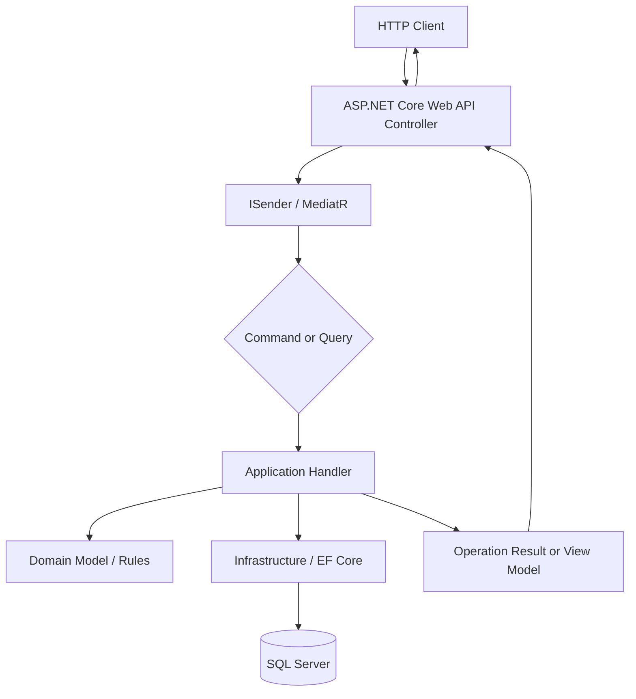

[MedicalSchedulingSystem_README.md](https://github.com/user-attachments/files/33256020/MedicalSchedulingSystem_README.md)
# Medical Scheduling System

A learning-focused ASP.NET Core Web API project built to explore **Clean Architecture**, **CQRS**, and **MediatR** together in a practical codebase. After studying these concepts individually, I wanted to understand how they work together in an actual application rather than only as separate ideas.

The business domain is intentionally kept small: the API manages patients and doctors and supports basic appointment scheduling. I chose a relatively straightforward domain on purpose. My main goal was not to build a large healthcare product or spend most of the time on complex business rules; it was to focus on architectural boundaries, request handling, dependency direction, and the trade-offs that come with these design choices.

This was my first project where I implemented CQRS in this form alongside MediatR and Clean Architecture. I had used CQRS-related ideas before, but this project gave me the opportunity to apply the pattern through explicit commands, queries, and request handlers.

> **Project scope:** This is an educational project, not a production-ready healthcare system. Do not use it to store real patient information. Production use would require additional work, including a full security model, authorization policies, stronger validation, operational configuration, monitoring, and a comprehensive test strategy.

## Features

### Patient management

- Create a patient record.
- Update patient information.
- Retrieve a patient by ID.
- Retrieve the patient list.

### Doctor management

- Create a doctor record.
- Update doctor information.
- Retrieve a doctor by ID.
- Retrieve the doctor list.

### Appointment management

- Book an appointment for a patient with a doctor.
- Change an existing appointment's doctor, date, or time.
- Cancel an appointment.
- Retrieve appointments associated with a patient.

The API uses a shared `OperationResult` response for command operations and dedicated view models for query responses. Controllers translate application results into HTTP responses such as `200 OK`, `400 Bad Request`, and `404 Not Found` where applicable.

## Architecture and design

The solution is split into projects with distinct responsibilities rather than placing API, application, and persistence concerns in a single project.

```text
MedicalSchadulingSystem
├── Application
│   ├── MS.Application.Contracts
│   │   ├── Commands
│   │   ├── Queries
│   │   ├── View models / request contracts
│   │   └── OperationResult
│   └── MS.Application
│       └── MediatR request handlers
├── Domain
│   └── MS.Domain
│       └── Core domain model
├── Infrastructure
│   ├── MS.Infrastructure.Configuration
│   │   └── Dependency-injection and application wiring
│   └── MS.Infrastructure.EFCore
│       └── Entity Framework Core persistence for SQL Server
└── Presentation
    └── MS.Presentation.WebApi
        └── ASP.NET Core controllers and API configuration
```

### Request flow

The API controllers remain thin and delegate application requests through MediatR's `ISender` abstraction.



### Why CQRS and MediatR?

Commands represent operations that change application state, such as creating a patient or booking an appointment. Queries represent read operations, such as retrieving a doctor or listing a patient's appointments. Keeping these request types separate makes each use case easier to identify and gives it a focused handler.

MediatR provides the request-dispatching mechanism between the presentation layer and those handlers. Initially, this abstraction felt like an extra layer. While implementing the project, I gained a better understanding of how it can reduce direct coupling between controllers and application logic and make request processing more explicit.

### Project responsibilities

| Project | Responsibility |
|---|---|
| `MS.Presentation.WebApi` | HTTP endpoints, controllers, API pipeline, and Swagger/OpenAPI configuration. |
| `MS.Application.Contracts` | Commands, queries, result contracts, and view models used to express application requests and responses. |
| `MS.Application` | Application-side request handling and coordination of use cases through MediatR. |
| `MS.Domain` | The core healthcare scheduling domain model, kept separate from API and persistence implementation details. |
| `MS.Infrastructure.EFCore` | SQL Server persistence using Entity Framework Core. |
| `MS.Infrastructure.Configuration` | Dependency registration and wiring used by the Web API to configure the application. |

## Technology stack

- **Language:** C#
- **Framework:** .NET 10 / ASP.NET Core Web API
- **Application request handling:** MediatR
- **Architecture:** Clean Architecture with CQRS-style command/query separation
- **ORM:** Entity Framework Core
- **Database:** Microsoft SQL Server
- **API documentation:** Swagger / Swashbuckle and OpenAPI

## Getting started

### Prerequisites

- .NET 10 SDK
- A reachable SQL Server instance
- A connection string configured for the application's database

### 1. Clone the repository

```bash
git clone https://github.com/mahdinematix/MedicalSchadulingSystem.git
cd MedicalSchadulingSystem
```

### 2. Configure the database connection

The application reads the connection string named `MedicalSchedulingSystemDb` through .NET configuration. For local development, configure it in `appsettings.Development.json` or use .NET User Secrets. Do not commit passwords or other credentials to source control.

Example configuration (replace the server and authentication settings with values for your own environment):

```json
{
  "ConnectionStrings": {
    "MedicalSchedulingSystemDb": "Server=YOUR_SQL_SERVER;Database=MedicalSchedulingSystemDb;Trusted_Connection=True;TrustServerCertificate=True;"
  }
}
```

Make sure the SQL Server database schema is configured for the current Entity Framework Core model before starting the API.

### 3. Restore and build

```bash
dotnet restore MedicalSchadulingSystem.slnx
dotnet build MedicalSchadulingSystem.slnx
```

### 4. Run the Web API

```bash
dotnet run --project Presentation/MS.Presentation.WebApi/MS.Presentation.WebApi.csproj
```

In the Development environment, Swagger UI is enabled by the application configuration. Use it to explore the available patient, doctor, and appointment actions and inspect their request models.

## Learning outcomes

The main value of this project for me was the architectural practice rather than the size of the feature set. It helped me:

- Apply Clean Architecture and CQRS together in a concrete .NET solution.
- Separate commands from queries and route each request through a MediatR handler.
- Think more deliberately about which layer should own each responsibility.
- Reduce the direct dependency between API controllers and application use-case implementation.
- Understand the practical trade-offs of introducing abstractions instead of adding layers by default.

I previously worked more often with Onion Architecture, so this project was also an opportunity to become more comfortable with Clean Architecture and compare the way each style guides boundaries and dependencies. I now pay closer attention to these decisions when designing backend applications.

## Current scope and possible improvements

The codebase is intentionally small and should be treated as a learning exercise. Possible next steps include adding automated tests, improving request validation and error handling, tightening API route templates, introducing a complete authentication and authorization model, and adding production-oriented observability and deployment configuration.

## License

No license information is specified here. Add a license file if you intend to define how others may use, modify, or distribute this project.
